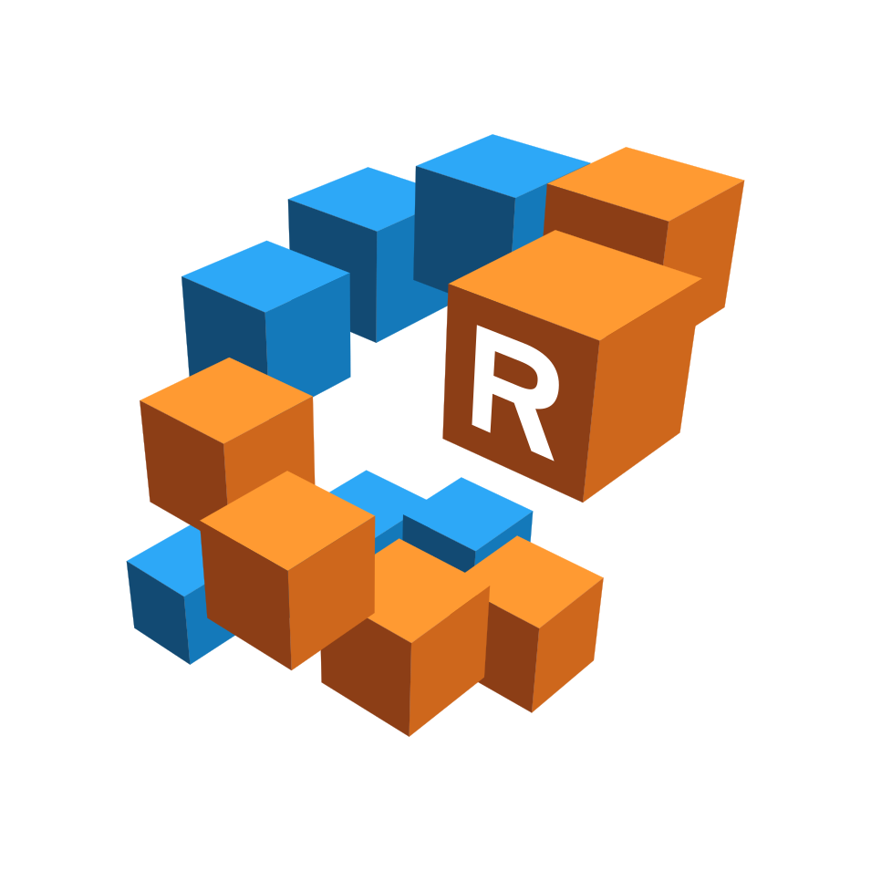
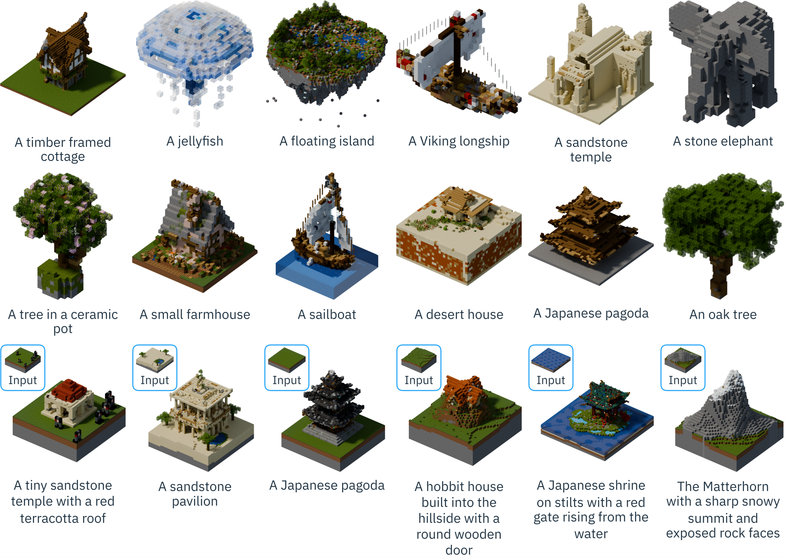
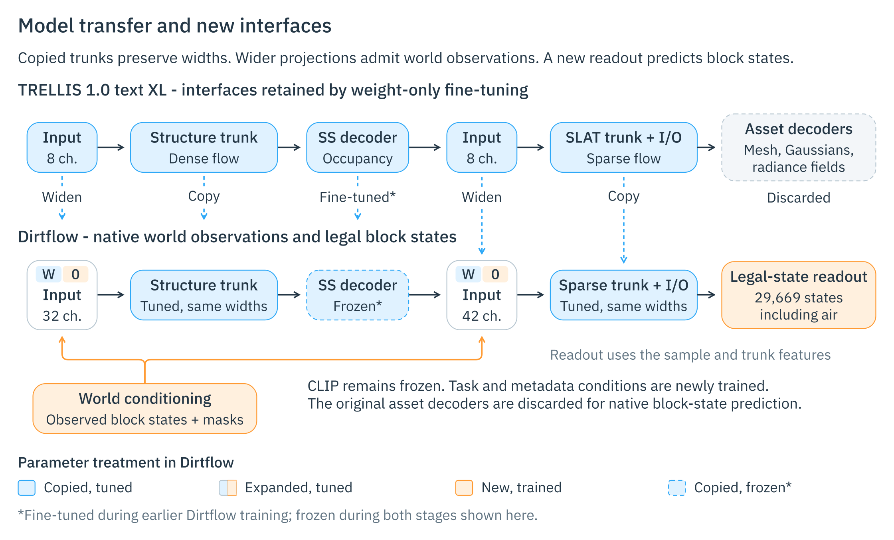

<h1> Dirtflow</h1>

[Research](https://github.com/IvanBanny/dirtflow-v0) |
[Model](https://huggingface.co/IvanBanny/dirtflow-v0) |
[Engine](https://github.com/IvanBanny/dirtflow-v0-engine) |
[Mod](https://github.com/IvanBanny/dirtflow-v0-mod) |
[Demo](https://huggingface.co/spaces/IvanBanny/dirtflow-v0)

Dirtflow generates Minecraft builds from text and the surrounding blocks. It can build within existing terrain or edit part of a construction. This repository contains the (minimal) PyTorch implementation and training code for **Dirtflow: Adapting 3D Generative Models for Minecraft World Editing**.

You can try the model in the [browser demo](https://huggingface.co/spaces/IvanBanny/dirtflow-v0), or use the [mod](https://github.com/IvanBanny/dirtflow-v0-mod) and [engine](https://github.com/IvanBanny/dirtflow-v0-engine) to select and edit regions inside Minecraft.



Selected examples from the paper, with the engine's block-placement corrections. The first two rows were generated in empty space; the last row shows the input terrain beside each result.

## Model

Consider adding a house to a hillside. The model needs to see the slope and know where it is allowed to build. We give it the existing blocks and two masks: `observed` records which cells we have read from the world (including air), and `edit` marks the cells it can change. For a repair, it also sees the blocks left in the damaged wall. We put the selection and its surroundings on a 64 x 64 x 64 grid, one cell per Minecraft block.

We start from the two text-conditioned XL flow models in [TRELLIS 1.0](https://github.com/microsoft/TRELLIS). The first generates geometry; the second generates features at the occupied locations. We fine-tune both to read Minecraft worlds and replace TRELLIS's mesh, Gaussian and radiance-field decoders with a classifier over block states. Both Transformers keep their 28 blocks of width 1280 and cross-attention to frozen CLIP ViT-L/14 text features.



The structure stage works in the latent space of an occupancy VAE. We first fine-tune this VAE on Minecraft builds, then freeze it while training the flow. It compresses a binary 64 x 64 x 64 occupancy grid into an eight-channel 16 x 16 x 16 latent. A new convolutional encoder reads the observed block states and masks and produces 16 channels on that same latent grid. We concatenate these with the eight-channel noisy latent and the previous step's eight-channel estimate of the clean latent (self-conditioning). The Transformer takes these 32 channels and predicts an eight-channel velocity for the occupancy latent. We decode the sampled latent to occupancy and pass the occupied cells inside the selection to the material stage.

The material stage generates an eight-dimensional vector at each candidate location. It also reads nearby observed blocks and air. Sparse convolutions extract local features, and 2 x 2 x 2 pooling reduces the number of tokens passed to the Transformer. The output is upsampled back to the original coordinates through sparse convolution blocks with skip connections. World observations and self-conditioning expand this flow's input from 8 to 42 channels; its velocity output still has eight channels. For both flows, we copy the pretrained input weights and initialize the added columns to zero, then train the whole projection.

A new readout converts the material vectors to one of 29,669 legal Minecraft 1.21.11 block states, including properties such as a stair's orientation. It takes the sampled vector and the material network's final 256-dimensional features (before the velocity projection, from the last text-conditioned sampling step). We train the readout and block embeddings from scratch, together with the world encoder and added task and metadata embeddings. The coordinates are fixed; the readout can remove a block by predicting air.

Both stages use continuous flow matching. At inference, we start from Gaussian noise and integrate the predicted velocities with 30 Euler steps per stage and classifier-free text guidance of 5. After predicting the block states, we copy the original blocks outside the selection back into the result.

## Sampling

Use Python 3.12 and [uv](https://docs.astral.sh/uv/). The lockfile installs PyTorch with CUDA 13.2. GPU sampling requires BF16 support; `--device cpu` uses FP32.

```bash
git clone https://github.com/IvanBanny/dirtflow-v0.git
cd dirtflow-v0
uv venv --python 3.12 ~/.venvs/dirtflow-research
UV_PROJECT_ENVIRONMENT=~/.venvs/dirtflow-research uv sync --frozen --extra dev
source ~/.venvs/dirtflow-research/bin/activate
python sample.py "a small stone cottage with a wooden roof" \
    --size 20 20 20 --seed 42 --output outputs/cottage.voxel
```

The first run downloads 9.3 GB of weights and model assets from Hugging Face into the same cache used by the engine. `python -m dirtflow.download` downloads them separately and prints the directory to use with `--bundle`.

`--size` gives the selection's X, Y and Z dimensions, with Y pointing up. The selection is limited to 10,000 cells and 58 cells along any axis. The output contains the full 64 x 64 x 64 grid in the voxel-tensor-v1 format; [voxel.py](dirtflow/voxel.py) has the reader and writer. This sampler stops after block-state prediction. The engine also applies placement rules, for example to handle gravity and the two halves of a door.

To edit an existing world, save an NPZ file with three arrays of shape `[64, 64, 64]`:

| Array | Contents |
| --- | --- |
| `before` | Existing block-state IDs, `int64` |
| `observed` | Boolean mask of cells read from the world, including air |
| `edit` | Boolean mask of cells to generate or replace |

IDs refer to `assets/input-registry.json` in the model directory. [Schema.normalize_input()](dirtflow/schema.py) converts a block-state string to an ID. Every editable cell must be observed; set `before` to zero outside `observed`.

```bash
python sample.py "a stone wall" --input world.npz --task repair \
    --seed 42 --output outputs/wall.voxel
```

`repair` includes the surviving blocks in the material stage's candidate locations. Use `--task material_only` to change materials while keeping the existing occupied cells. For Python use, [Sampler.generate()](dirtflow/sampling.py) accepts the same arrays and returns the block-state grid.

## Training

We train the stages separately, using a velocity prediction loss for each ([objectives.py](dirtflow/objectives.py)). Material training also includes cross-entropy over block states and a term to discourage the learned embeddings from collapsing. Its coordinates come from the occupied cells of the training build. We sometimes add patches of air so it learns to remove excess candidates, but we don't train it on incomplete generated structures.

The training corpus is not redistributed. To train on your own builds, prepare voxel-tensor-v1 files and a JSONL list of their paths and captions. Paths are relative to the list; at least two builds are needed for replacement tasks.

```json
{"path":"builds/cottage.voxel","captions":["a small stone cottage with an oak roof"]}
{"path":"builds/tower.voxel","captions":["a square stone tower"]}
```

Each build can have one to five captions. With five captions, we assign a style embedding to each in this order: factual, evocative, tags, structured attributes, second person. Optional `weight` controls how often a build is sampled within its domain; `score` supplies a quality score from 0 to 10 (omit it to use the unknown-score condition).

```bash
bundle=$(python -m dirtflow.download)
python prepare.py --sources /data/sources.jsonl --bundle "$bundle" \
    --output /data/prepared
```

This converts block states to registry IDs and caches CLIP text features. During training, [tasks.py](dirtflow/tasks.py) constructs edits from these complete builds: generation in empty space or on a flat ground plane, completion, replacement, repair, and material assignment on fixed geometry. You can also construct training pairs yourself; [data.py](dirtflow/data.py) defines the NPZ fields and index format.

The configs in [configs/](configs/) use a global batch of six and 8-bit AdamW. Structure training runs for 2.04 million examples and material training for 2.40 million, counting repeated builds and crops. Peak learning rates are 3e-5 for pretrained parameters and 3e-4 for new parameters.

By default, the structure config mixes Minecraft builds with mesh examples, reducing the mesh share from 30% to 5% over training. For Minecraft-only data, change `get_config()` in `configs/structure.py` to return `Config(replay_initial=0, replay_final=0)`. To include meshes, voxelize them first and set `domain` in their source rows to 1 for shells or 2 for filled meshes; Minecraft rows use 0, the default. Material training uses only Minecraft rows.

```bash
UV_PROJECT_ENVIRONMENT=~/.venvs/dirtflow-research uv sync --frozen --extra train --extra dev
torchrun --standalone --nproc-per-node=6 train.py \
    --config configs/structure.py --bundle "$bundle" \
    --data /data/prepared/index.jsonl --output /runs/structure
torchrun --standalone --nproc-per-node=6 train.py \
    --config configs/materials.py --bundle "$bundle" \
    --data /data/prepared/index.jsonl --output /runs/materials
```

These commands continue training the released weights with a fresh optimizer. You can use one, two or three GPUs by changing `--nproc-per-node`; gradient accumulation keeps the global batch at six. `--max-updates 2` runs a short check. To resume an interrupted run, add `--resume /runs/structure/checkpoint.pt` (or the material checkpoint). TensorBoard logs are written to the run directory.

To initialize the flows from TRELLIS instead, download the two checkpoints from its [Text XL release](https://huggingface.co/microsoft/TRELLIS-text-xlarge/tree/e0b00432b8e3a8ecee0df806ab1df9f7281f2be4/ckpts):

```bash
python initialize.py --bundle "$bundle" \
    --structure-flow /models/trellis/ss_flow_txt_dit_XL_16l8_fp16.safetensors \
    --material-flow /models/trellis/slat_flow_txt_dit_XL_64l8p2_fp16.safetensors \
    --output /models/dirtflow-initial --seed 0
```

Then use `--bundle /models/dirtflow-initial` in the training commands. The occupancy VAE is already adapted to Minecraft and remains frozen; this command initializes the two flows and their new inputs and readout.

To use the trained model with the engine, export the checkpoints:

```bash
python export.py --bundle "$bundle" \
    --structure /runs/structure/checkpoint.pt \
    --materials /runs/materials/checkpoint.pt --output /models/my-dirtflow
```

Export selects the exponential moving average (EMA) weights for structure and the directly optimized weights for materials. Load the result with `dirtflow-engine --model /models/my-dirtflow`.

## Development

The model definitions are in [dirtflow/model/](dirtflow/model/). [sampling.py](dirtflow/sampling.py) contains the generation loops, and [training.py](dirtflow/training.py) contains optimization and checkpoint resume.

```bash
OMP_NUM_THREADS=2 MKL_NUM_THREADS=2 CUDA_VISIBLE_DEVICES='' pytest -m 'not integration'
ruff check --no-cache dirtflow tests configs *.py
ruff format --check --no-cache dirtflow tests configs *.py
mypy --cache-dir /tmp/dirtflow-research-mypy dirtflow
python -m build
```

To run the [CUDA training and generation tests](tests/test_integration.py) with the released weights:

```bash
DIRTFLOW_TEST_BUNDLE="$(python -m dirtflow.download)" \
OMP_NUM_THREADS=2 MKL_NUM_THREADS=2 pytest -m integration
```

Set `DIRTFLOW_ENGINE_SRC` to the engine checkout's `src/` directory to also compare generated grids between the two implementations. Set `DIRTFLOW_TRELLIS` to a directory containing the two TRELLIS checkpoints to test `initialize.py`.

## License

Code and released weights are licensed under Apache 2.0; see [LICENSE](LICENSE) and the [model license](https://huggingface.co/IvanBanny/dirtflow-v0/blob/main/LICENSE). Third-party code notices are in [LICENSES/](LICENSES/). Training-data and Minecraft asset rights remain with their respective owners.
